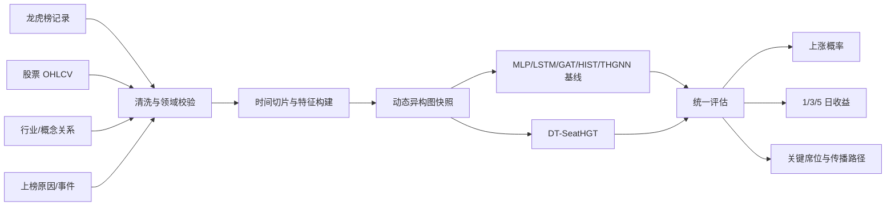

# SeatFlow 初始化架构

## 边界

- `data` 只负责输入记录、字段校验和未来真实数据适配器。
- `graph` 负责节点、关系、时间衰减和快照，不耦合训练框架。
- `models` 固定模型输入输出契约；PyTorch/PyG 实现后续接入。
- `services` 把模型输出转换为平台可消费的预测结果。
- `cli` 提供可验证入口，不承载业务逻辑。

## 初始化决策

- 核心包使用 Python 标准库即可运行，避免环境未准备时项目完全不可验证。
- 配置使用 TOML，由 Python 3.11 的 `tomllib` 直接读取。
- 图数据层先使用显式 dataclass，待真实数据契约稳定后再张量化到 PyG `HeteroData`。
- smoke 预测器只是端到端契约验证，不参与模型效果声明。
