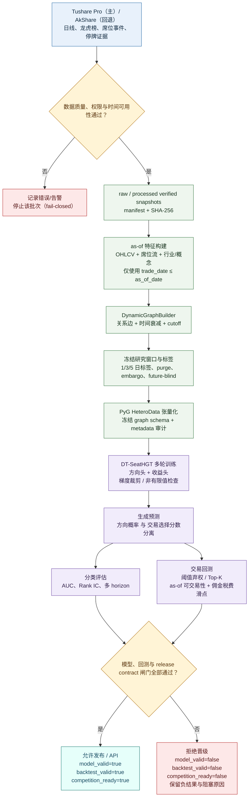

# SeatFlow 研究与发布流程图

这张图展示 SeatFlow 从市场数据采集、时间一致性处理、动态图构建、DT-SeatHGT 训练，到分类评估、交易回测和发布闸门的完整流程。

## 关键设计决策

1. **先审计、后建模**：provider 权限、字段质量、可用时间和快照哈希不通过时，流程在数据入口停止，不生成可被误读的模型结论。
2. **所有研究对象按 `as_of_date` 冻结**：特征、图边、标签和可交易性检查都遵守时间截点，并用 purge、embargo、future-blind 降低时间泄漏风险。
3. **分类概率与交易分数分离**：AUC/Rank IC 衡量预测能力，阈值弃权、Top-K、可交易性和成本回测衡量能否形成交易选择，避免一个分数承担两种语义。
4. **发布采用 fail-closed**：只有模型、回测和 release contract 同时通过，才允许 `competition_ready=true`；否则保留负结果和具体阻塞原因。

